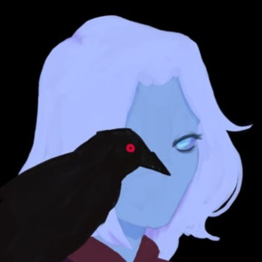

<p align="center"></p>
<h1 align="center">Yuri Lua</h1>
<p align="center">Build scripts for Yuri Aniimo and Yuri Loftia.</p>

## Start here

New to Lua? Read the [quick start](docs/QUICKSTART.md), then edit the
[quickstart example](examples/quickstart/main.lua). The examples include
their own `script.json` manifests so you can see exactly which permissions
they request. Scripts start OFF and changed versions need another review.

**This is a development SDK snapshot: API 1.2, helpers 1.2.2.** Gameplay
examples require the matching updated Yuri desktop worker and game host.
Uploading these files does not update anyone's launcher or unlock APIs in an
older public game package. See [compatibility](docs/COMPATIBILITY.md).
The SDK and in-game script manager are still being developed.

## What can I make?

- Script pages with buttons, toggles, sliders, messages and saved settings.
- Nearby-resource labels and game-state displays from approved snapshots.
- Conditional use of supported Yuri features with script-owned cleanup.
- Sequential workflows and one-shot travel tasks that observe arrival.
- Aniimo ability-readiness displays; Loftia owned-bed/resource/tool helpers.

Capabilities differ between games. There is no unrestricted native or memory
API. Individual crop commands, full inventory counts, normal skill casting
and arbitrary movement are not implemented by this SDK yet. Observing arrival
does not prove gathering or server-side success. Read [current progress](docs/PROGRESS.md)
for the tested scope and remaining work.

## Find your way around

| Path | Contents |
| --- | --- |
| [docs/QUICKSTART.md](docs/QUICKSTART.md) | First working script, explained step by step. |
| [docs/API.md](docs/API.md) | Controls, callbacks, settings, timers and limits. |
| [docs/GAMEPLAY.md](docs/GAMEPLAY.md) | Permissioned game data, actions, features and labels. |
| [docs/ACTION-TASKS.md](docs/ACTION-TASKS.md) | Travel and equip observations with timeouts. |
| [docs/WORKFLOWS.md](docs/WORKFLOWS.md) | Compose steps without endless loops. |
| [examples/](examples/) | Foundation and Aniimo/Loftia source examples. |
| [sdk/](sdk/) | Editor declarations and host helper sources. |
| [tools/](tools/) | Validate and package source without running Lua. |

## For creators

In a matching development launcher, use **Script library → New script**,
choose the game and template, and open its folder. Edit `main.lua`, then
**Review & enable**. The current Loftia SDK controls are desktop-only;
a dynamically managed in-game Lua page remains future work.

```lua
local status = yuri.label("Ready")
yuri.button("Say hello", function()
    status:set_text("My script works!")
    yuri.notify("Hello from my script")
end)
```

Use the declarations under `sdk/` for editor autocomplete. The helper sources
under `sdk/runtime/` are host-provided; you do not load them from each script.

## For contributors and maintainers

```text
python tools/catalogue_tool.py validate
python -m unittest discover -s tools/tests
```

For this update ZIP before merging into a repository containing `catalogue.json`:

```text
python tools/catalogue_tool.py validate --examples-only
```

See [CONTRIBUTING.md](CONTRIBUTING.md), [publishing](docs/PUBLISHING.md),
[security boundaries](SECURITY.md) and [upload instructions](docs/UPDATING.md).
Publishing scripts to the catalogue is separate from updating SDK source.
The tools do not upload files, edit the live catalogue, or execute submitted Lua.

## Project links

[Aniimo](https://github.com/Slyrith/Yuri-Aniimo) ·
[Loftia](https://github.com/Slyrith/Yuri-Loftia) ·
[Launcher](https://github.com/Slyrith/Yuri-Launcher) ·
[Discord](https://discord.gg/DvP8UxQP3J) ·
[Support Yuri](https://www.paypal.com/ncp/payment/ZFAGRQRSCT6SQ)

A repository-wide license has not been selected. Contributors must state the
rights they grant for their own scripts; do not assume an open-source license.
